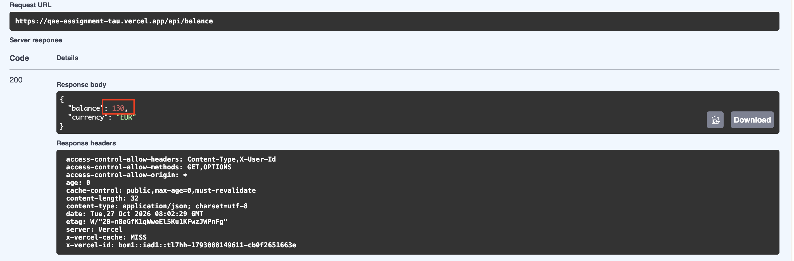
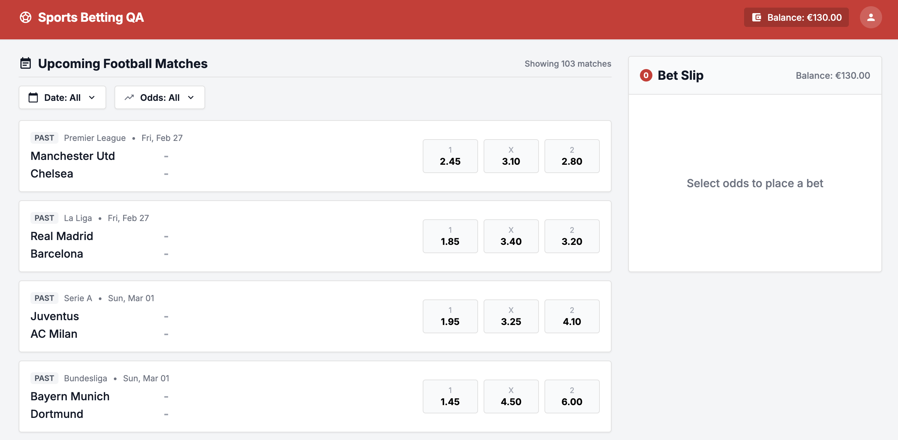
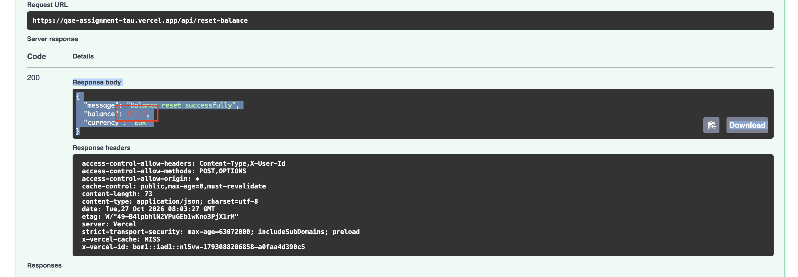
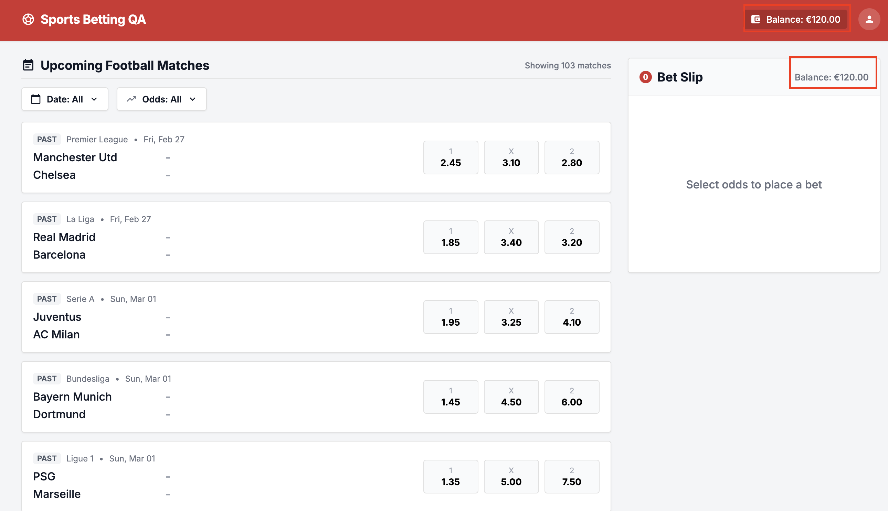
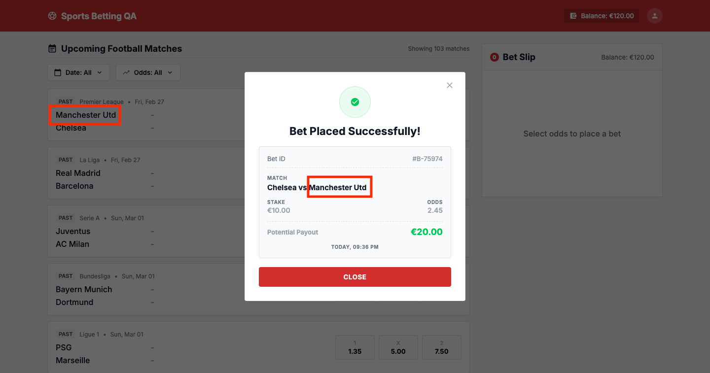
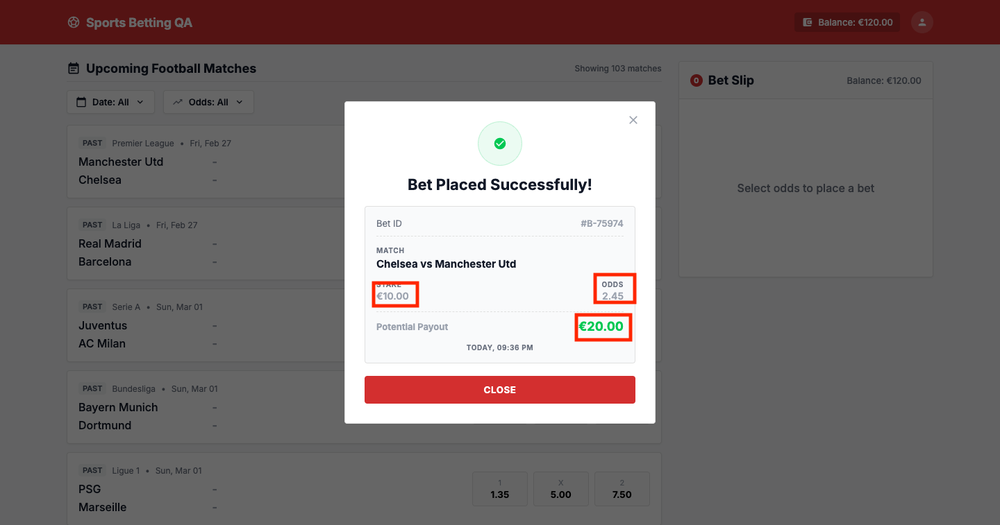
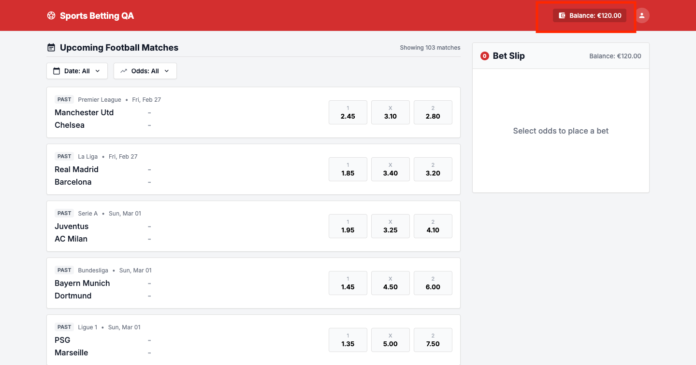
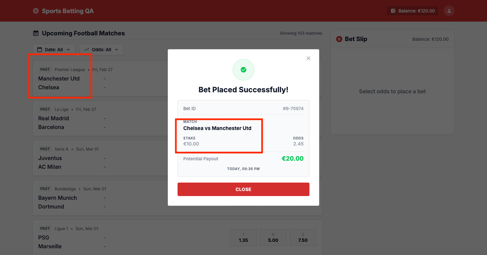

# Bug Reports

**Application:** https://qae-assignment-tau.vercel.app (Sports Betting QA, v1.0.0)
**API docs:** https://qae-assignment-tau.vercel.app/api/docs
**Environment:** macOS, Google Chrome (latest), Swagger UI, Python + pytest + Selenium
**Date:** 27 Oct 2026

## Summary

All bugs are covered by automated tests marked `xfail` with their bug ID, so the test suite tracks these known bugs until they are fixed.

| ID | Title | Severity | Area | Found by |
|----|-------|----------|------|----------|
| BUG-01 | Negative stake is accepted and credits money to the balance | Critical | API: `POST /api/place-bet` | API test + manual (Swagger) |
| BUG-02 | Reset balance response does not match the stored balance | Medium | API: `POST /api/reset-balance` | API test setup + manual (Swagger) |
| BUG-03 | Receipt shows the teams in reverse order | High | UI: bet receipt | E2E UI test |
| BUG-04 | Receipt shows the wrong potential payout (stake × 2) | Critical | UI: bet receipt | E2E UI test |
| BUG-05 | Balance is not updated in the UI after a successful bet | High | UI: header / bet slip | E2E UI test |
| BUG-06 | Bets are accepted on matches that have already been played | Critical | UI + API: match list / place-bet | API + UI tests |

---

## BUG-01: Negative stake is accepted and credits money to the balance

**Severity:** Critical
**Area:** API: `POST /api/place-bet`
**Found by:** automated API test `test_invalid_stake_is_rejected[negative]`, confirmed manually in Swagger UI

### Preconditions
- A valid user id is sent in the `x-user-id` header.
- The balance has been reset. `GET /api/balance` returns **120.00**.

### Steps to reproduce
1. Send `GET /api/balance` and note the balance: **120.00**.
2. Send `POST /api/place-bet` with this body:
   ```json
   {
     "matchId": "premier-league-manutd-chelsea",
     "selection": "HOME",
     "stake": -10
   }
   ```
3. Send `GET /api/balance` again.

### Expected result
- The request is rejected with **`422 Unprocessable Entity`** and `"error": "invalid_stake_min"`. The minimum stake is €1.00.
- The balance stays at **120.00**.

### Actual result
- The request is accepted with **`200 OK`**, and the bet is placed.
- The balance **increases** to **130.00**: 120 − (−10) = 130.

### Impact
- Anyone calling the API directly can **credit themselves unlimited money** by placing bets with negative stakes. The UI's stake checks don't protect against this.
- This is a direct financial loss and fraud risk, and it breaks the core rule that the stake must be between €1.00 and €100.00.

### Evidence
- Automated test output: `test_invalid_stake_is_rejected[negative] FAILED, assert 200 == 422`
- Balance before: **120.00**. Balance after: **130.00**.




### Suggested fix
Validate the stake on the server before any balance change: it must be a number, ≥ 1.00, ≤ 100.00, have at most 2 decimals, and not exceed the current balance.

---

## BUG-02: Reset balance response does not match the stored balance

**Severity:** Medium
**Area:** API: `POST /api/reset-balance`
**Found by:** API test setup (the starting balance was 120 instead of 125.50), confirmed manually in Swagger UI and the UI

### Preconditions
- A valid user id is sent in the `x-user-id` header.

### Steps to reproduce
1. Send `POST /api/reset-balance` and note the balance in the response.
2. Send `GET /api/balance`, or open the app at `/?user-id=<id>` and check the header balance.

### Expected result
- The reset response returns `"balance": 125.5`.
- `GET /api/balance` and the UI also show **€125.50**. Spec §5.3 requires the reset response and the stored state to be consistent.

### Actual result
- The reset response returns:
  ```json
  {
    "message": "Balance reset successfully",
    "balance": 125.5,
    "currency": "EUR"
  }
  ```
- `GET /api/balance` and the UI header show **€120.00**, a difference of €5.50.

### Impact
- Any client or test that trusts the reset response works with the wrong balance.
- Testers and automated tests can't reliably return to the documented starting balance of €125.50.
- The app reports one balance and stores another, which undermines trust in balance data.

### Evidence
- Reset response: `"balance": 125.5`.
- `GET /api/balance` and the UI header after the reset: **120.00**.




### Workaround used in automation
The test fixtures read the starting balance from `GET /api/balance` after each reset, not from the reset response, so tests compare against the real stored value.

---

## BUG-03: Receipt shows the teams in reverse order (away vs home)

**Severity:** High
**Area:** UI: bet receipt (success modal)
**Found by:** automated E2E test `test_place_single_bet`

### Steps to reproduce
1. Open the app with a valid user id.
2. On "Manchester Utd vs Chelsea", click odds **1** (home win).
3. In the bet slip, note the teams: "Manchester Utd vs Chelsea".
4. Enter stake `10.00` and click **Place Bet**.
5. Check the Match field on the receipt.

### Expected result
The receipt shows **"Manchester Utd vs Chelsea"** (home team first), the same as the match list and the bet slip.

### Actual result
The receipt shows **"Chelsea vs Manchester Utd"** (away team first).

### Impact
- The customer may think they backed the other team, especially since the receipt doesn't show the selection (1 / X / 2).
- The receipt is the customer's proof of bet. Wrong match details lead to disputes and support tickets.

### Evidence
- Test output: `AssertionError: 'Chelsea vs Manchester Utd' != 'Manchester Utd vs Chelsea'`



---

## BUG-04: Receipt shows the wrong potential payout (stake × 2 instead of stake × odds)

**Severity:** Critical
**Area:** UI: bet receipt (success modal)
**Found by:** automated E2E test `test_place_single_bet`

### Steps to reproduce
1. Open the app with a valid user id.
2. On "Manchester Utd vs Chelsea", click odds **1** (2.45).
3. Enter stake `10.00`. The bet slip shows Potential Payout **€24.50** (correct).
4. Click **Place Bet**.
5. Check Potential Payout on the receipt.

### Expected result
The receipt shows **€24.50** (10.00 × 2.45), the same as the bet slip before placement.

### Actual result
The receipt shows **€20.00**. The payout is calculated as stake × 2, ignoring the odds.

### Impact
- The customer's proof of bet states the wrong amount they'll be paid.
- For any odds other than 2.00 the amount is wrong: lower for higher odds, higher for lower odds. That leads to disputes and complaints, and misleading financial information is a regulatory risk.

### Evidence
- Test output: `assert 20.0 == 24.5` on `receipt.get_payout()`
- Bet slip before placement: **€24.50**. Receipt after placement: **€20.00**.



---

## BUG-05: Balance is not updated in the UI after a successful bet

**Severity:** High
**Area:** UI: header balance and bet slip balance
**Found by:** automated E2E test `test_place_single_bet`

### Steps to reproduce
1. Open the app with a valid user id. The header shows **€120.00**.
2. On "Manchester Utd vs Chelsea", click odds **1**, enter stake `10.00`, and click **Place Bet**.
3. When the receipt appears, click **Close**.
4. Check the balance in the header and in the bet slip.

### Expected result
Both show **€110.00** immediately after the bet. The spec says the balance is shared across the header and the bet slip and must stay in sync.

### Actual result
Both still show **€120.00**, even after a 10-second wait. *(Confirm: after a page reload the header shows €110.00, and `GET /api/balance` returns 110.)*

### Impact
- The customer sees money they no longer have.
- The bet slip's "Insufficient balance" check uses the old amount, so the user can try bets they can't afford. They then see only a generic error instead of a clear message.

### Evidence
- Test output: `TimeoutException: ('id', 'header-balance') does not contain '€110.00'` after a 10-second explicit wait.



---

## BUG-06: Bets are accepted on matches that have already been played

**Severity:** Critical
**Area:** UI + API: match list and `POST /api/place-bet`
**Found by:** automated tests `API/tests/test_past_match.py` and `UI/tests/test_past_match.py` (TC-04), confirmed manually in the app

### Steps to reproduce
1. Open the app with a valid user id (current date: 27 Oct 2026).
2. Look at the first match, "Manchester Utd vs Chelsea": it has the badge **PAST** and the date **Fri, Feb 27**.
3. Click odds **1**, enter stake `10.00` and click **Place Bet**.

### Expected result
The product is for **pre-match** bets on **upcoming** matches only. Past matches are either hidden or shown without bettable odds, and `POST /api/place-bet` rejects bets on them.

### Actual result
- Past matches are listed with active odds buttons (the list even shows a **PAST** badge).
- The bet is **accepted**: "Bet Placed Successfully!" with a Bet ID, and the stake is deducted.

### Impact
- Users can bet on matches whose result is already known: a direct financial loss and a fraud risk.
- Breaks the core rule of the product (pre-match only).

### Evidence


